# WireGuard Access Orchestrator

**Network Security Automation · Python · WireGuard · nftables · Linux**

A lightweight laboratory for automated VPN peer provisioning, group-based network access control, and continuous security policy reconciliation.

Runs on a **single Linux VM**, without cloud services or additional virtual machines.

> **Scope:** isolated security engineering demonstration, not a production-ready VPN service.

## Access-control workflow




## Capabilities

- Automatic provisioning and revocation of individual WireGuard peers
- Group-based TCP destination and port allowlists with nftables default-drop filtering
- Detection and remediation of missing peers, rogue peers, and stale nftables set membership
- Detection and repair of unauthorized changes to the project's nftables table
- Revocation of old access and key retirement after group changes
- Fail-closed demonstration when the authorization source becomes invalid during an active VPN session

## Quick start — Kali Linux

Requirements: Python 3.10+, Bash, iproute2, wireguard-tools, nftables, unshare, and sysctl.

```bash
# Unit tests — no root
python3 -m unittest discover -s tests/unit -v

# Show local trusted users
PYTHONPATH=src python3 -m wgao users

# Full live integration suite — disposable network namespaces
sudo bash scripts/run_integration.sh all

# Review measured durations
python3 tools/metrics.py summary metrics/results/*.json
```

You can also run `full` or `active-fail-closed` separately. The original `scripts/live_wg_nft_lab.sh` command remains available.

## Project structure

| Path | Purpose |
|---|---|
| `src/wgao/` | Broker, registry, policy generation, reconciliation and integrity checks |
| `config/` | Example identity roster and resource allowlists |
| `scripts/lab/lib/` | Disposable network topology and reconciler setup |
| `tests/unit/` | Unprivileged Python unit tests |
| `tests/integration/` | Separate live network security scenarios |
| `tools/metrics.py` | Measurements and JSON reports |
| `metrics/results/` | Generated, Git-ignored test results |
| `docs/` | Architecture, workflows, tests and security limitations |

## Documentation

- [Architecture](docs/architecture.md)
- [Security workflows](docs/workflows.md)
- [Testing and metrics](docs/testing.md)
- [Security model and limitations](docs/security.md)

**Known limitations:** the roster is trusted administrator input, not user authentication. Server-side peer restoration may require a client-side WireGuard handshake reset. Fail-closed depends on a running reconciler. Policy integrity is limited to the WGAO-owned nftables table. The TCP/443 test server is not HTTPS/TLS. All timings are VM observations, not performance guarantees.
