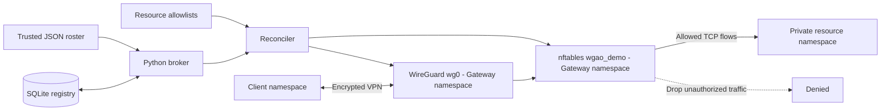

# Architecture and trust boundaries

## Network topology

| Namespace | Interfaces and addresses |
|---|---|
| Client | `eth0 192.0.2.2/30`, `wg0 10.77.0.100/32`, second simulated client `wg1` |
| Gateway | `eth0 192.0.2.1/30`, `wg0 10.77.0.1/24`, `eth1 10.200.1.1/24` |
| Resource | `eth0 10.200.1.10/24`, TCP/443 allowed and TCP/444 denied |

The second client is simulated using another WireGuard interface in the same client namespace, selected with a temporary route. This is a testing convenience, not two separate physical clients.

The local trusted-roster interface has no public authentication endpoint. All firewall modifications take place in a disposable Linux network namespace.
