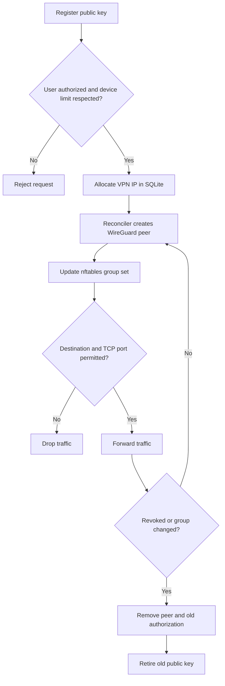
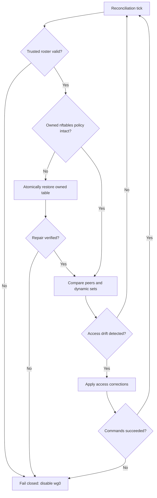

# Access lifecycle and security workflows

## Device provisioning and revocation

## Reconciliation and fail-closed

Recreating a missing server-side WireGuard peer sometimes requires a client-side handshake reset to restore connectivity. The laboratory tests and documents this behavior.
